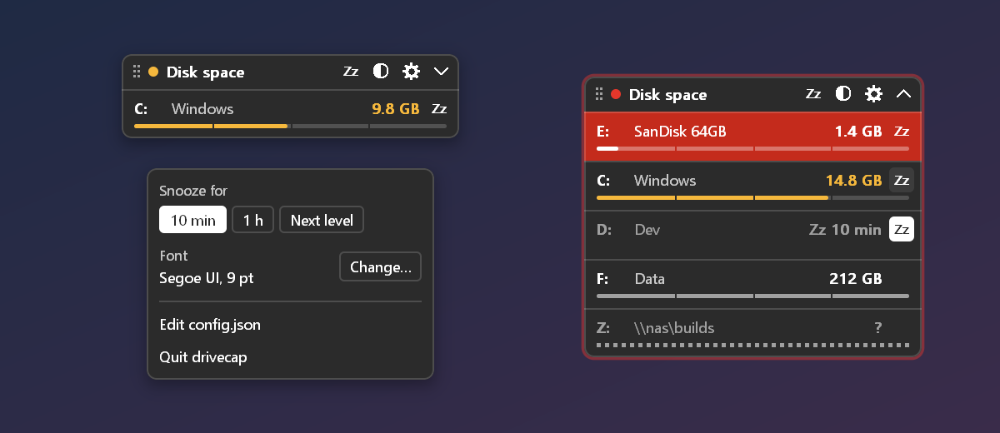
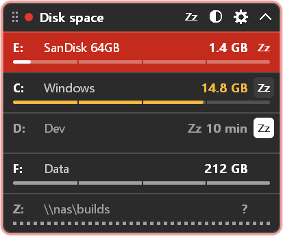
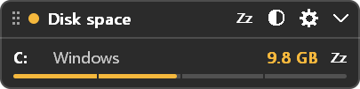
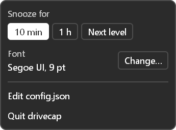
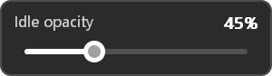
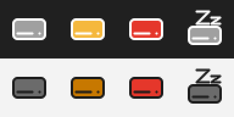

# Drivecap

**Know a drive is filling up *before* your build fails.**

[](https://github.com/jamison-wilde/drivecap/actions/workflows/ci.yml)
[](LICENSE)


Drivecap is a small Windows tray app that watches your drives and shows a
compact, always-on-top card when free space gets low. Build trees,
worktrees and package caches quietly eat tens of gigabytes until
something breaks. Drivecap warns you early, escalates as space gets
tight, and stays out of your way the rest of the time.



## Features

- **Escalating warnings.** The card appears when free space drops below
  a threshold (default 20 GB) and again at every step below it (every
  5 GB). Between crossings it reminds you more and more often, from
  every 60 s at the threshold to every 10 s near the end.
- **Dire mode.** At 2 GB free the drive's row turns red and the card
  stays on screen with a slow halo until you deal with it.
- **No nagging.** A level you were already warned about stays quiet if
  free space wobbles around it. Snooze one drive or all of them for
  10 minutes, an hour, or until the next level. A new crossing always
  breaks through.
- **Never in the way.** The card never takes focus, and clicks pass
  through it while it's idle. Rest the cursor on it for a moment to
  interact, and drag it wherever you like. It remembers the spot on each
  monitor.
- **Runway bars.** Each row shows how much space is left before the
  threshold, with a notch at every warning level.
- **Sensible defaults.** Internal drives are watched out of the box. USB
  sticks and USB hard drives are left out unless you opt them in, and a
  rule follows a drive across drive letters.
- **Network folders and mount points.** Add them by path. Shares are
  checked on a background thread, so a dead share shows `?` instead of
  freezing anything.
- **Tray icon.** Its colour shows the worst drive at a glance. Click it
  to see every drive.
- Light and dark mode, high-DPI and multi-monitor aware. Per-user install,
  no admin rights, starts at login.

## Screenshots

<table>
  <tr>
    <td align="center">
      <picture>
        <source media="(prefers-color-scheme: light)" srcset="docs/images/card-light.png">
        
      </picture>
      <br><sub>Expanded: every watched drive, worst first</sub>
    </td>
    <td align="center">
      <picture>
        <source media="(prefers-color-scheme: light)" srcset="docs/images/card-minimized-light.png">
        
      </picture>
      <br><sub>Minimized: only drives that need attention</sub>
    </td>
  </tr>
  <tr>
    <td align="center">
      <picture>
        <source media="(prefers-color-scheme: light)" srcset="docs/images/popup-settings-light.png">
        
      </picture>
      <br><sub>Settings: snooze length, font, config, quit</sub>
    </td>
    <td align="center">
      <picture>
        <source media="(prefers-color-scheme: light)" srcset="docs/images/popup-opacity-light.png">
        
      </picture>
      <br><sub>Idle opacity, previewed live on the card</sub>
      <br><br>
      
      <br><sub>Tray icon: healthy, warning, dire, snoozed</sub>
    </td>
  </tr>
</table>

## Install

1. Download `drivecap-<version>-x64.msi` from the
   [latest release](https://github.com/jamison-wilde/drivecap/releases/latest).
2. Run it. Drivecap installs to `%LOCALAPPDATA%\Drivecap\` (no admin
   prompt), starts at login, adds a Start Menu shortcut, and offers to
   launch right away.

Uninstall from **Settings → Apps**. Your settings in `~/.drivecap/` are
kept.

> The MSI isn't code-signed yet, so Windows SmartScreen may ask you to
> confirm before it runs.

## Using it

| Where | What |
|---|---|
| Tray icon, left-click | Show the card with every drive. Click again to hide it. |
| Tray icon, right-click | Snooze ▸, Volumes ▸ (pick which drives to watch), Font…, Edit config.json, Quit drivecap |
| Card header **Zz** | Snooze every drive that needs attention and hide the card. Click again to wake them. |
| Card header ◐ | Idle opacity (how see-through the card is when you're not pointing at it) |
| Card header ⚙ | Snooze length, font, edit config, quit |
| Card header chevron | Switch between all drives and warned drives only |
| Row **Zz** | Snooze just that drive |
| Right-click a row | Snooze ▸, Hide this volume, Volumes ▸, Font…, Edit config.json, Quit |
| Drag the header | Move the card. The position is remembered per monitor. |

When something needs attention, the card fades in, holds for a few
seconds, and fades out. It doesn't wait for a click, and it doesn't
steal focus. A dire card is the exception: it stays on screen and
clickable until the drive recovers or you snooze it. A dire drive can
only be snoozed for a set time, never "until next level".

`drivecap status` prints the watched drives, their free space and zone.
Run `drivecap --help` for the other options.

## Configuration

Settings live in `~/.drivecap/config.json` (`%USERPROFILE%\.drivecap\`).
The file is written with defaults on first run and reloaded within two
seconds whenever you save it. A file that doesn't parse is left untouched;
drivecap keeps running on its previous settings and logs a warning.

```jsonc
{
  "defaults": { "thresholdGb": 20, "stepGb": 5, "direGb": 2 },
  "volumes": [
    // Per-drive overrides, matched by volume ID; "label" is just for you.
    { "id": "\\\\?\\Volume{…}\\", "label": "E: SanDisk 64GB", "thresholdGb": 8, "enabled": true }
  ],
  "extraPaths": ["C:\\dev", "\\\\nas\\builds"],   // mount points and network folders
  "includeUsb": false,
  "pollIntervalSecs": 60,
  "idleOpacityPct": 50,
  "snooze": "10min",                // "10min" | "1h" | "nextLevel"
  "mode": "expanded",               // "expanded" | "minimized"
  "font": { "face": "Segoe UI", "pointSize": 9, "weight": 400 },
  "colors": { "light": { "warning": "#C77800" }, "dark": {} },
  "scalePct": 100,
  "direHalo": true,                 // false = pulsing border instead of a halo
  "levelGaps": true
}
```

- Sizes are in GB as Explorer shows them (1 GB = 1024³ bytes).
- Picking drives in **Volumes ▸** writes their IDs for you; you never need
  to type a volume GUID. To bring back a network folder or mount point
  you hid, set its `enabled` entry to `true` or delete it.
- A path in `extraPaths` that lives on a drive already being watched
  doesn't get its own row.
- Fade, hold and reminder timings live under `timings`.
- The card position is saved in `~/.drivecap/position.json`. Logs go to
  `%TEMP%\drivecap.log`, which rolls over to `drivecap.log.1` at 5 MB.

## Build from source

Requires Windows, the [Rust toolchain](https://rustup.rs/) and, for the
installer, [WiX v7](https://wixtoolset.org/) with the Util and UI
extensions.

```bash
cargo build --release -p drivecap-cli          # target/release/drivecap.exe
cargo test
./scripts/build-msi.sh                         # target/wix/drivecap-<version>-x64.msi
```

Before pushing, run the full check:

```bash
cargo fmt && cargo clippy --all-targets && cargo test && ./scripts/doc-check.sh
```

The README images are rendered by the real drawing code:
`cargo test -p drivecap-cli --lib -- --ignored dump_readme_images && node scripts/readme-images.mjs`.

## How it's built

Drivecap is a single Rust binary that uses the Win32 API directly
(`windows` crate, GDI and layered windows). It has no UI framework and no
web view. Every decision about when to warn, when to fade and what to
draw lives in plain, unit-tested modules. Thin Win32 layers only carry
those decisions out. See [`CLAUDE.md`](CLAUDE.md) for the module map and
[`docs/adrs/`](docs/adrs/) for the design decisions.

## License

MIT. See [`LICENSE`](LICENSE).
